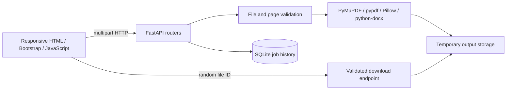

# PDF Maker — Advanced PDF Processing API

PDF Maker is a local-first document processing web app built with FastAPI. It offers PDF merge, split, optimization, text extraction, metadata inspection, PDF/DOCX conversion, page rendering, and image-to-PDF tools. The existing interface also includes page arranging, image compression, and image resizing.

## Features

- Validates file extensions, actual PDF/DOCX signatures, image decoding, upload sizes, PDF page counts, and page ranges.
- Stores processed outputs under random IDs and records operation metadata in SQLite. It does not put document contents in the database.
- Expires stored files after `FILE_RETENTION_HOURS` (default 24); cleanup runs when processing a new job.
- Limits PDF uploads to 50 MiB and 300 pages by default; page image conversion is capped at 50 pages and 300 DPI.
- PDF to DOCX preserves extracted text order and paragraph breaks as best effort; complex layout, tables, columns, and scanned PDFs will not convert perfectly. OCR is not included.
- DOCX to PDF uses LibreOffice when available. On serverless hosts without it, a bundled ReportLab fallback converts text and tables and clearly warns that complex formatting and images are not preserved.
- Swagger docs are available at `/docs`.

## Architecture



## Stack

Python 3.12, FastAPI, Uvicorn, PyMuPDF, pypdf, python-docx, Pillow, python-multipart, SQLite, Bootstrap 5, and vanilla JavaScript. Exact dependency versions are pinned in `requirements.txt`.

## Windows setup

Run these commands in PowerShell from the project root (`D:\projects\pdfmaker`):

```powershell
py -3.12 -m venv .venv
.\.venv\Scripts\Activate.ps1
python -m pip install --upgrade pip
pip install -r requirements.txt
Copy-Item .env.example .env
uvicorn app.main:app --app-dir backend --reload --env-file .env
```

Open <http://127.0.0.1:8000> for the app and <http://127.0.0.1:8000/docs> for Swagger. Install LibreOffice if you need DOCX-to-PDF; then ensure `soffice` is on PATH or set `LIBREOFFICE_PATH` in `.env` to the full executable path. Run the tests from project root with `python -m pytest backend/tests -q`.

If PowerShell blocks venv activation, use `\.venv\Scripts\python.exe -m pip install -r requirements.txt` and `\.venv\Scripts\python.exe -m uvicorn app.main:app --app-dir backend --reload --env-file .env`. If a port is busy, add `--port 8001`. For upload-limit changes, set `MAX_UPLOAD_SIZE` in bytes. The database and output directory are created automatically.

## API

| Method | Endpoint | Purpose |
|---|---|---|
| GET | `/api/health` | Health check |
| GET | `/api/tools` | Supported operations |
| POST | `/api/pdf/merge` | Merge 2–20 PDFs in upload order |
| POST | `/api/pdf/split` | Extract ranges such as `1-3,5` (1-based) |
| POST | `/api/pdf/compress` | Optimize PDF (level 1–3), report actual byte sizes |
| POST | `/api/pdf/to-docx` | Extract PDF text into DOCX |
| POST | `/api/docx/to-pdf` | Convert using LibreOffice or the clearly labeled basic ReportLab fallback |
| POST | `/api/pdf/extract-text` | Download page-numbered text as TXT |
| POST | `/api/pdf/to-images` | Render up to 50 pages into a PNG ZIP |
| POST | `/api/images/to-pdf` | Convert 1–20 PNG/JPEG files |
| POST | `/api/pdf/metadata` | Inspect an uploaded PDF's metadata |
| GET | `/api/pdf/metadata?file_id=...` | Inspect a stored PDF by generated file ID |
| GET | `/api/jobs` | Recent history |
| GET | `/api/jobs/{job_id}` | One job record |
| GET | `/api/download/{file_id}` | Download a generated output |

On local and Docker deployments, processing endpoints return JSON containing a `download_url`, `job_id`, and actual size information. On Vercel, they return the generated file directly because function instances do not share a durable local filesystem. DOCX conversion responses identify the selected engine and report the basic renderer's limitations. Example using PowerShell:

```powershell
curl.exe -F "file=@sample.pdf" -F "pages=1-2" http://127.0.0.1:8000/api/pdf/split
curl.exe -F "files=@one.pdf" -F "files=@two.pdf" http://127.0.0.1:8000/api/pdf/merge
```

## Tests

```powershell
python -m pytest backend/tests -q
```

Tests create small PDFs in memory and do not access private files or external services.

## Docker deployment

Copy `.env.example` to `.env`, then run `docker compose up --build`. Compose persists the database and temporary files in the `pdf-studio-data` volume. The image includes LibreOffice Writer and a health check. Vercel runs functions on a read-only filesystem except for ephemeral `/tmp`, so this app switches its temporary storage there and returns generated files directly from the processing request. Vercel currently limits function request and response bodies to 4.5 MB; PDF Maker caps uploads and generated output below that limit. Vercel's `/tmp` and SQLite history are ephemeral and are not durable across instances. Use the Docker deployment or another Python host with persistent storage for larger files and durable history. Static-only hosting cannot run this API. Provider free tiers vary and may impose strict storage, memory, and runtime limits.

## Security, limitations, and future improvements

This project is intended for local use or deployment behind an appropriately configured gateway. Configure a narrow CORS origin allowlist and HTTPS in production. It has no authentication, per-user history separation, distributed rate limiting, OCR, malware scanning, or background job queue. SQLite history is shared by the service instance. Cleanup is opportunistic on new work, so a quiet service can retain files past their configured expiry until another request processes a job. Add a scheduled cleanup task and user authentication before exposing it publicly to multiple users. PDF-to-DOCX is text-focused and not a layout-preserving converter. Further improvements could include OCR, task progress, authenticated workspaces, per-user quotas, and richer layout reconstruction.

## Screenshots and interview walkthrough

Screenshots will be added after capturing the running application; none are fabricated here.

For an interview demo, show `/docs`, validate an invalid upload, merge sample PDFs, split a page range, download the generated result using its random ID, then explain validation, storage expiry, and the tradeoffs of text-focused conversion.
